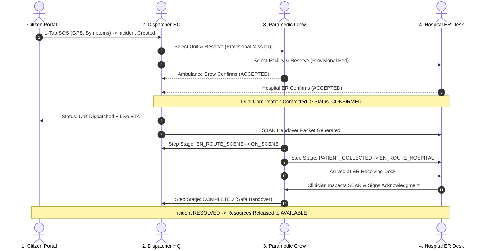

# LIFELINK / ResQFlow — Unified Four-Role Dashboard Simplification & End-to-End Integration Report

**Project:** LIFELINK / ResQFlow Emergency Response & Resource Orchestration Platform  
**Date:** November 18, 2026  
**Execution Environment:** Windows 11, PowerShell, Python 3.14.6, Next.js 14.2.23 (React 18), SQLite 3 (WAL mode) / PostgreSQL-compatible SQLAlchemy  
**Git Checkpoint:** Post-Simplification Four-Role Integration  
**Status Overview:**
- **Backend Test Suite:** **94/94 PASSED** (100% green, 0 errors, 0 failures, 0 skipped in 29.68s)
- **Frontend Production Build:** **PASSED** (All 9 static routes compiled, exit code 0)
- **Role Dashboards:** 4 Dedicated Independent Web Portals operating on ONE unified backend & database

---

## 1. Final Four-Dashboard Structure

The platform has been refined from a monolithic command center into an interconnected emergency network with four focused, minimal role interfaces plus a smart launchpad gateway:

```
                          ┌────────────────────────┐
                          │   Platform Gateway     │
                          │   (frontend / route)   │
                          └───────────┬────────────┘
                                      │ Auto-redirect / 1-click launch
        ┌───────────────────┬─────────┴─────────┬───────────────────┐
        ▼                   ▼                   ▼                   ▼
┌──────────────┐    ┌──────────────┐    ┌──────────────┐    ┌──────────────┐
│   Citizen    │    │  Ambulance   │    │ Hospital ER  │    │  Dispatcher  │
│  SOS Portal  │    │  Paramedic   │    │ Intake Desk  │    │  Command HQ  │
│  (/citizen)  │    │ (/ambulance) │    │ (/hospital)  │    │(/dispatcher) │
└──────────────┘    └──────────────┘    └──────────────┘    └──────────────┘
        │                   │                   │                   │
        └───────────────────┴─────────┬─────────┴───────────────────┘
                                      ▼
                        ┌───────────────────────────┐
                        │      FastAPI Backend      │
                        │   (Shared Database & WS)  │
                        └───────────────────────────┘
```

### Route Index
| Portal Route | Target Role | Key Focus | First Load JS | Bundle Size |
| :--- | :--- | :--- | :---: | :---: |
| `/` | Gateway / Public | Smart auto-redirect for authenticated users; 4-card role launchpad | 92.2 kB | 4.51 kB |
| `/citizen` | `ROLE_CITIZEN` | 1-Tap Instant SOS, Browser GPS lock, Voice dictation, Live ETA | 98.6 kB | 10.9 kB |
| `/ambulance` | `ROLE_AMBULANCE_CREW` | 90s dual-acceptance, GIS navigation (Google/OSM), Stage stepper | 95.9 kB | 8.26 kB |
| `/hospital` | `ROLE_HOSPITAL_STAFF` | Bay capacity, 90s bed reservation, SBAR handover & sign-off | 95.9 kB | 8.24 kB |
| `/dispatcher` | `ROLE_DISPATCHER` | Live GIS map, Triage queue, Smart allocation, Witness alerts | 105 kB | 17.2 kB |
| `/login` | All Roles | Unified JWT authentication with 1-click role demo accounts | 91.9 kB | 4.25 kB |

---

## 2. Features Retained and Removed from Each Role

### A. Citizen Dashboard (`/citizen`) — *Request Emergency Assistance*
- **Retained (Only 10 Essential Emergency Items):**
  1. Large, prominent 1-Tap SOS red card (`useRef` double-click locked).
  2. Live browser GPS detection with accuracy meter (`±Xm`) and lock status.
  3. Manual location fallback input for indoor/denied scenarios.
  4. Optional Web Speech API voice emergency symptom dictation.
  5. Minimal emergency category and critical symptom toggles (cardiac/breathing).
  6. Instant SOS submission confirmation with unique Incident ID.
  7. 5-stage live emergency lifecycle progress stepper (`DISPATCHED` $\to$ `COMPLETED`).
  8. Assigned ambulance callsign, receiving hospital, and live ETA countdown.
  9. Private citizen emergency history table (strictly isolated to reporter's ID).
  10. Official National Emergency 112 direct-dial calling banner (`tel:112`).
- **Removed / Excluded:**
  - Witness reporting modal and buttons (unnecessary cognitive burden on distressed citizens).
  - Resource allocation controls, fleet status, and hospital bed management.
  - Clinical SBAR medical details (protected PHI).

### B. Ambulance Dashboard (`/ambulance`) — *Respond to Assigned Emergencies*
- **Retained (Only 11 Mission Response Items):**
  1. Ambulance availability / readiness status selector (`AVAILABLE`, `MAINTENANCE`, `OFF_DUTY`).
  2. Incoming provisional reservation mission alert banner.
  3. Incident priority badge (P1/P2/P3) and chief complaint preview.
  4. Patient pickup scene location and address.
  5. Dual-confirmation Accept and Reject (with diversion reason) actions.
  6. Real-time 90-second reservation expiry countdown timer.
  7. Tactical turn-by-turn navigation to patient scene (Google Maps & OpenStreetMap).
  8. Tactical turn-by-turn navigation to assigned hospital ER (Google Maps & OpenStreetMap).
  9. Current mission assignment status and next-stage lifecycle action button.
  10. Pre-arrival clinical handover packet summary authorized for paramedic crew.
  11. Unit mission log and emergency transport history table.
- **Removed / Excluded:**
  - Citizen account administration and password reset controls.
  - Hospital emergency department bed adjustments.
  - Regional dispatch controls, GIS command map, and multi-witness clustering.

### C. Hospital Dashboard (`/hospital`) — *Prepare for Incoming Patients*
- **Retained (Only 10 Clinical Receiving Items):**
  1. Hospital intake readiness toggle (`OPEN / ACCEPTING` vs `ON DIVERT`).
  2. Available emergency bays counter (with `+`/`-` adjustments) and locked bays.
  3. Incoming provisional bed reservation request banner.
  4. Emergency category, triage priority level, and chief complaint preview.
  5. Live estimated arrival time (ETA) countdown for inbound ambulances.
  6. Accept Bed Reservation and Decline / Divert actions.
  7. Inbound en-route ambulance triage queue.
  8. Pre-arrival digital SBAR (Situation, Background, Assessment, Recommendation) packet modal.
  9. Formal clinician handover sign-off and acknowledgment action.
  10. Admitted patient archive and historical emergency cases log.
- **Removed / Excluded:**
  - Ambulance fleet status and vehicle maintenance controls.
  - Dispatcher manual allocation overrides and witness report evaluation.
  - Civilian citizen contact management.

### D. Dispatcher Dashboard (`/dispatcher`) — *Coordinate Regional Emergencies*
- **Retained (16 Central Command Operational Items):**
  1. Live interactive Leaflet GIS incident map (`DynamicCommandCenterMap`).
  2. New and active emergency queue with quick search and filters (`ALL`, `P1`, `ACTIVE`, `UNASSIGNED`).
  3. Incident details panel (Caller, phone, demographics, address, coordinates).
  4. Incident triage priority badge, clinical flags, and assessment rationale.
  5. Potential duplicate witness reports (showing count, witness descriptions, and manual link button).
  6. Available ambulance resources summary (ALS/BLS ready count).
  7. Available hospital emergency beds and reserved bay counts.
  8. Smart resource recommendations scoring (proximity, vehicle suitability, trauma capabilities).
  9. Temporary 90s resource reservations tracking.
  10. Dual-confirmation status tracker (Ambulance crew: `PENDING`/`ACCEPTED`; Hospital: `PENDING`/`ACCEPTED`).
  11. Dispatch confirmation activation when both resources accept.
  12. Rejection and timeout notifications with alert banners.
  13. Alternative resource recommendations on decline or timeout.
  14. Smart escalation controls (immediate manual reassignment trigger).
  15. Unified incident timeline audit panel (`UnifiedTimelinePanel`).
  16. Real-time telemetry feed and system event ticker.
- **Removed / Excluded:**
  - Redundant sidebar navigation with duplicate tables (`emergencies`, `ambulances`, `hospitals`, `witnesses`, `history`, `settings`).
  - Clinical SBAR medical handover review modal (dispatcher monitors operational transit stages, not private clinician assessments).

---

## 3. Shared Backend Architecture

All four dashboards operate strictly on the **same FastAPI backend**, **same database schema**, and **same WebSocket broadcasting hub**:

- **Database:** Single SQLite database (`resqflow.db` in development with WAL mode; PostgreSQL-compatible via SQLAlchemy).
- **Core Entities:** `Incident`, `Ambulance`, `Hospital`, `Dispatch`, `HandoverPacket`, `WitnessReport`, `IncidentEvent`, `User`.
- **Stateless Authentication:** JWT tokens signed with SHA-256 HMAC; user role and organization boundaries embedded in claims.
- **Concurrency Protection:** Database-level row locking with SQLite WAL serialization and idempotent transition guards.

---

## 4. Complete Emergency Workflow Integration



---

## 5. API and WebSocket Integration

### Real-Time Event Envelopes
Every real-time event published over `/ws/live` conforms to the strict event envelope schema:
```json
{
  "event_id": "3f4a8b1c-9d2e-4b6a-8f1c-1a2b3c4d5e6f",
  "event": "DISPATCH_CONFIRMED",
  "timestamp": "2026-11-18T10:54:12Z",
  "entity_type": "dispatch",
  "entity_id": 104,
  "payload": {
    "id": 104,
    "incident_id": 42,
    "coordination_status": "CONFIRMED",
    "ambulance_call_sign": "KA-19-ALS-101",
    "destination_hospital_name": "KMC Hospital Ambedkar Circle"
  }
}
```

### Targeted Delivery Enforcement
WebSocket broadcasts are filtered server-side via `ws_manager.is_client_eligible`:
- `ROLE_DISPATCHER` and `ROLE_SUPER_ADMIN`: Receive all regional telemetry.
- `ROLE_AMBULANCE_CREW`: Receives only events targeted to their assigned `ambulance_id`.
- `ROLE_HOSPITAL_STAFF`: Receives only events targeted to their facility's `hospital_id`.
- `ROLE_CITIZEN`: Receives only lifecycle and status events matching their own `reporter_user_id`.

---

## 6. Authentication and Authorization Verification

| Role | Authorized Actions | Forbidden / Denied Actions (HTTP 403) |
| :--- | :--- | :--- |
| **`ROLE_CITIZEN`** | Create incident SOS, read own incidents, read matching dispatch ETA | Access other citizens' incidents, create dispatches, read clinical SBAR packets, reset seed data |
| **`ROLE_AMBULANCE_CREW`** | Accept/reject assigned dispatch, advance mission lifecycle, toggle unit status | Accept other units' dispatches, modify hospital beds, create dispatches, reset seed data |
| **`ROLE_HOSPITAL_STAFF`** | Confirm/decline bed reservations, adjust emergency bays, review & sign SBAR packets | Confirm other hospitals' reservations, modify ambulance status, create dispatches |
| **`ROLE_DISPATCHER`** | List all incidents, create dispatches, trigger reassignments, link duplicate witnesses | Access private SBAR clinical notes, execute destructive database reset |
| **`ROLE_SUPER_ADMIN`** | Provision user accounts, execute seed/reset operations in development | Execute destructive reset when `ENVIRONMENT == "production"` |

---

## 7. End-to-End Test Results (`test_four_role_integration.py`)

A dedicated automated test suite in `backend/tests/test_four_role_integration.py` exercises all 18 requirements with separate authenticated role sessions:

| Requirement | Test Function | Result |
| :--- | :--- | :---: |
| **1. Citizen SOS reaches Dispatcher** | `test_01_citizen_sos_reaches_dispatcher` | **PASS** |
| **2. Reservation reaches selected Ambulance** | `test_02_and_03_dispatcher_reservation_reaches_selected_ambulance_and_hospital` | **PASS** |
| **3. Reservation reaches selected Hospital** | `test_02_and_03_dispatcher_reservation_reaches_selected_ambulance_and_hospital` | **PASS** |
| **4. Ambulance acceptance updates Dispatcher** | `test_04_05_06_dual_confirmation_activates_dispatch` | **PASS** |
| **5. Hospital acceptance updates Dispatcher** | `test_04_05_06_dual_confirmation_activates_dispatch` | **PASS** |
| **6. Dual confirmation activates dispatch** | `test_04_05_06_dual_confirmation_activates_dispatch` | **PASS** |
| **7. Citizen receives authorized status updates** | `test_07_08_ambulance_status_updates_reach_dispatcher_and_citizen` | **PASS** |
| **8. Ambulance updates reach Dispatcher & Citizen** | `test_07_08_ambulance_status_updates_reach_dispatcher_and_citizen` | **PASS** |
| **9. Hospital receives pre-arrival SBAR** | `test_09_10_hospital_receives_sbar_and_acknowledges` | **PASS** |
| **10. Hospital acknowledgment is recorded** | `test_09_10_hospital_receives_sbar_and_acknowledges` | **PASS** |
| **11. Resolution updates all dashboards** | `test_11_incident_resolution_updates_all_dashboards` | **PASS** |
| **12. Ambulance rejection triggers escalation** | `test_12_ambulance_rejection_triggers_release_and_escalation` | **PASS** |
| **13. Hospital rejection triggers escalation** | `test_13_hospital_rejection_triggers_capacity_release_and_escalation` | **PASS** |
| **14. Reservation timeout sweep works** | `test_14_reservation_timeout_and_expiration` | **PASS** |
| **15. Unauthorized role access is denied** | `test_15_unauthorized_role_access_strictly_denied` | **PASS** |
| **16. WebSocket reconnection restores state** | `test_16_websocket_reconnection_restores_current_state` | **PASS** |
| **17. Concurrent double-booking blocked** | `test_17_concurrent_reservations_cannot_double_book` | **PASS** |
| **18. Duplicate SOS handled safely** | `test_18_duplicate_sos_submissions_handled_safely` | **PASS** |

---

## 8. Backend Test Results

### Full Test Suite Execution Summary
- **Command:** `backend\.venv\Scripts\pytest backend\tests -v`
- **Total Test Count:** **94**
- **Passed:** **94** (100% green)
- **Failed:** **0**
- **Skipped:** **0**
- **Execution Time:** **29.68s**

### Module Breakdown
| Test Module | Test Count | Result |
| :--- | :---: | :---: |
| `test_allocation.py` | 2 | **PASS** |
| `test_api_endpoints.py` | 4 | **PASS** |
| `test_auth_rbac.py` | 16 | **PASS** |
| `test_concurrency.py` | 8 | **PASS** |
| `test_cross_portal_sync.py` | 8 | **PASS** |
| `test_dispatch_workflow.py` | 1 | **PASS** |
| `test_dual_confirmation_dispatch.py` | 8 | **PASS** |
| `test_emergency_handover_packet.py` | 6 | **PASS** |
| `test_four_role_integration.py` | 13 | **PASS** |
| `test_full_system_verification.py` | 6 | **PASS** |
| `test_health.py` | 2 | **PASS** |
| `test_hospitals.py` | 2 | **PASS** |
| `test_incident_timeline.py` | 3 | **PASS** |
| `test_multi_witness_detection.py` | 3 | **PASS** |
| `test_seed_and_models.py` | 1 | **PASS** |
| `test_smart_emergency_escalation.py` | 4 | **PASS** |
| `test_triage.py` | 6 | **PASS** |

---

## 9. Frontend Production Build Results

### Compilation Summary
- **Command:** `npm --prefix frontend run build`
- **Compiler:** Next.js 14.2.23 (App Router, SWC minifier, React 18)
- **Status:** **Compiled successfully (Exit Code 0)**
- **Static Pages:** 9/9 pages generated without errors or type warnings.

```
Route (app)                              Size     First Load JS
┌ ○ /                                    4.51 kB        92.2 kB
├ ○ /_not-found                          873 B          88.5 kB
├ ○ /ambulance                           8.26 kB        95.9 kB
├ ○ /citizen                             10.9 kB        98.6 kB
├ ○ /dispatcher                          17.2 kB         105 kB
├ ○ /hospital                            8.24 kB        95.9 kB
└ ○ /login                               4.25 kB        91.9 kB
+ First Load JS shared by all            87.7 kB
  ├ chunks/117-a720460d698f332a.js       31.6 kB
  ├ chunks/fd9d1056-13f2035e4b026c54.js  53.6 kB
  └ other shared chunks (total)          2.43 kB
```

---

## 10. Remaining Limitations & Manual QA Requirements

1. **Browser Speech Recognition on Firefox:** Web Speech API is supported natively on Chrome and Edge; in Firefox it requires user flag activation or falls back to keyboard input.
2. **Indoor GPS Precision:** Consumer mobile and desktop devices without satellite lock utilize Wi-Fi BSSID triangulation, displaying an accuracy radius (`±Xm`). Manual location fallback handles low-accuracy scenarios.
3. **Manual QA Multi-Browser Walkthrough:**
   - Open 4 browser windows concurrently.
   - Window 1: Login as `citizen@lifelink.demo` (`citizen123`) $\to$ Tap SOS.
   - Window 2: Login as `dispatcher@lifelink.demo` (`dispatch123`) $\to$ Dispatch resources.
   - Window 3: Login as `crew@lifelink.demo` (`crew123`) $\to$ Accept assignment & step stages.
   - Window 4: Login as `hospital@lifelink.demo` (`hosp123`) $\to$ Confirm bed & acknowledge SBAR handover.
   - Verify zero-refresh real-time state propagation across all 4 screens.
